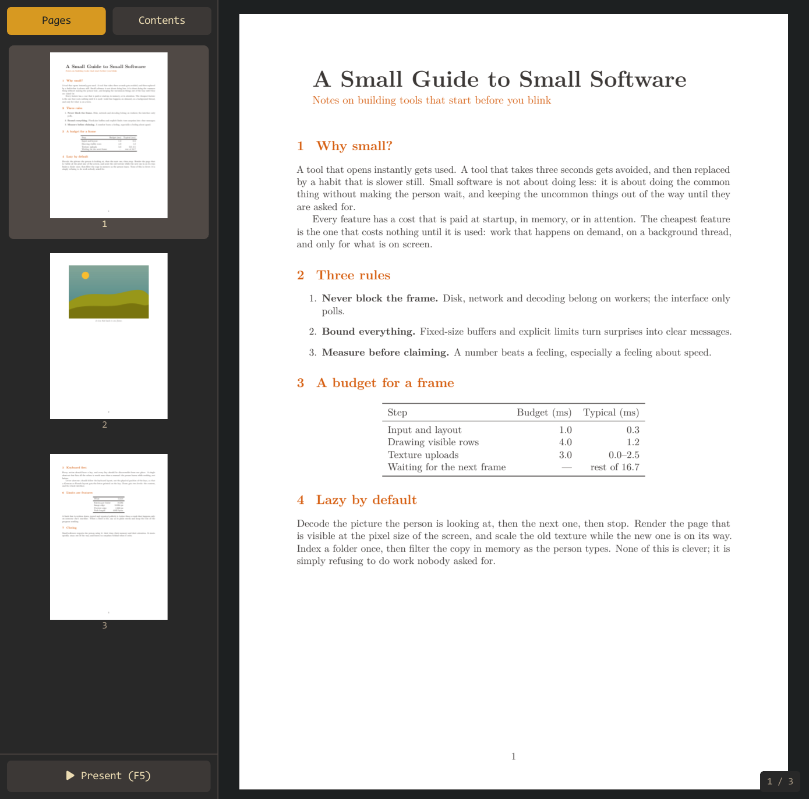

<p align="center">
  
</p>

<h1 align="center">mzp</h1>
<p align="center"><b>manifest ze pdf</b> · a minimal, fast PDF viewer for Wayland</p>

<p align="center">
  
</p>

**Press `Ctrl + K`** for all keyboard shortcuts, settings and the About page.

## Requirements to run

- Linux x86_64 with a **Wayland** session (no X11 / XWayland)
- OpenGL 3.3 graphics driver (Mesa or your GPU vendor's)
- `libwayland-client`, `libwayland-cursor`, `libwayland-egl`, `libxkbcommon`, `libEGL`: already present on any Wayland desktop

PDFium is bundled and installed with mzp.

Optional, for **scanned PDFs**: [Tesseract](https://tesseract-ocr.github.io) plus a language pack
(Void: `tesseract-ocr` and e.g. `tesseract-ocr-eng`). mzp then makes pages without text searchable and selectable,
only when you search or select on them. Ctrl + K → About shows whether it was found.

## Requirements to build

- [C3](https://c3-lang.org) compiler `c3c` **0.8.x**
- a C compiler for linking (`gcc` or `clang`)
- `git`, `python3`

raylib, PDFium and the UI font come with the repository and the [bmu](https://github.com/foelkdavid/bmu) submodule;
nothing else to install.

## Download, build, install

```sh
git clone --recurse-submodules https://github.com/foelkdavid/mzp.git
cd mzp
c3c build install --trust=full
```

This installs `~/.local/bin/mzp`, its PDFium library in `~/.local/lib/mzp/`, a desktop launcher ("Open with" for
PDFs) and the icon (no sudo). Make sure `~/.local/bin` is on your `PATH`, then run `mzp document.pdf`.

```sh
git pull --recurse-submodules && c3c build install --trust=full   # update
c3c build uninstall --trust=full                                   # uninstall
```

## Built with

| | used for | license |
|---|---|---|
| [C3](https://c3-lang.org) ([c3c](https://github.com/c3lang/c3c)) | language, compiler, standard library | [compiler LGPL-3.0, standard library MIT](https://github.com/c3lang/c3c#licensing) |
| [bmu](https://github.com/foelkdavid/bmu) | UI toolkit (submodule) | [MIT](licenses/BMU-LICENSE.txt) |
| [raylib](https://www.raylib.com) 6.0 | window, input, drawing (static) | [zlib](licenses/RAYLIB-LICENSE.txt) |
| [GLFW](https://www.glfw.org) 3.4 | Wayland window backend, inside raylib | [zlib](https://www.glfw.org/license.html) |
| [CodeNewRoman Nerd Font Propo](https://www.nerdfonts.com/font-downloads) | embedded UI font ([Code New Roman](https://github.com/ryanoasis/nerd-fonts/tree/master/patched-fonts/CodeNewRoman) by Sam Radian + [Nerd Fonts](https://github.com/ryanoasis/nerd-fonts) icons) | [SIL OFL 1.1](licenses/FONT-OFL.txt) |
| [PDFium](https://pdfium.googlesource.com/pdfium/) via [pdfium-binaries](https://github.com/bblanchon/pdfium-binaries) | PDF rendering, text, search (bundled `libpdfium.so`) | [BSD-3-Clause](licenses/pdfium/pdfium.txt) (+ [third-party](licenses/pdfium/)), build scripts [MIT](licenses/pdfium/LICENSE) |
| [Tesseract](https://tesseract-ocr.github.io) ([code](https://github.com/tesseract-ocr/tesseract)) | OCR for scanned pages, optional, run from the system | [Apache-2.0](https://github.com/tesseract-ocr/tesseract/blob/main/LICENSE) |

The bmu, font, raylib and PDFium notices (with PDFium's third-party libraries: FreeType, ICU, libjpeg-turbo, …) are in
[`licenses/`](licenses/) and are installed with the app.

## License

mzp is MIT-licensed (see [`LICENSE`](LICENSE)); the third-party parts keep their own licenses listed above.
